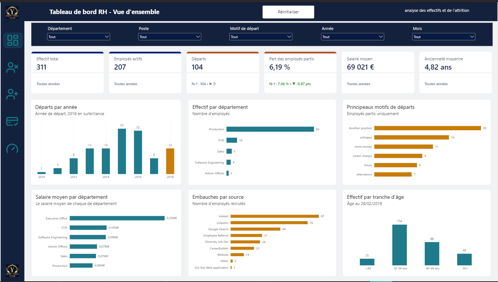
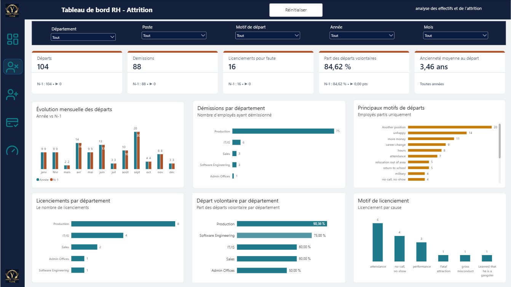
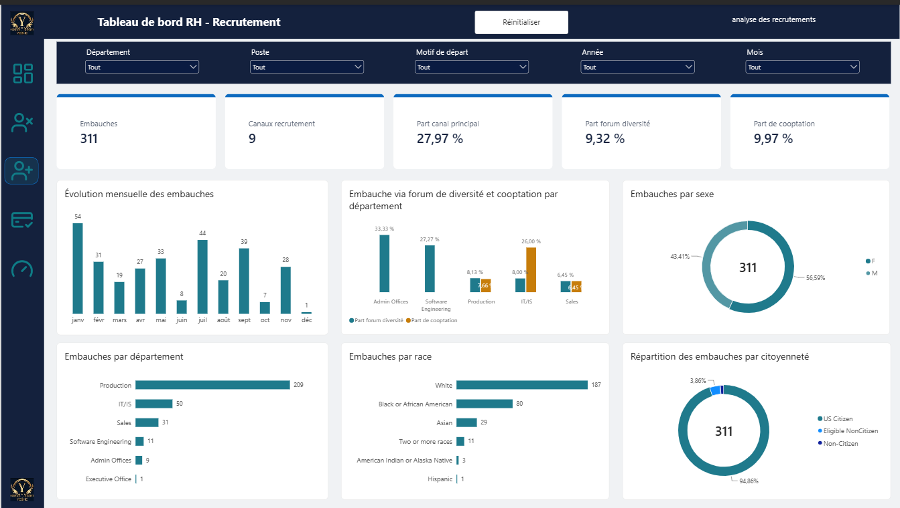
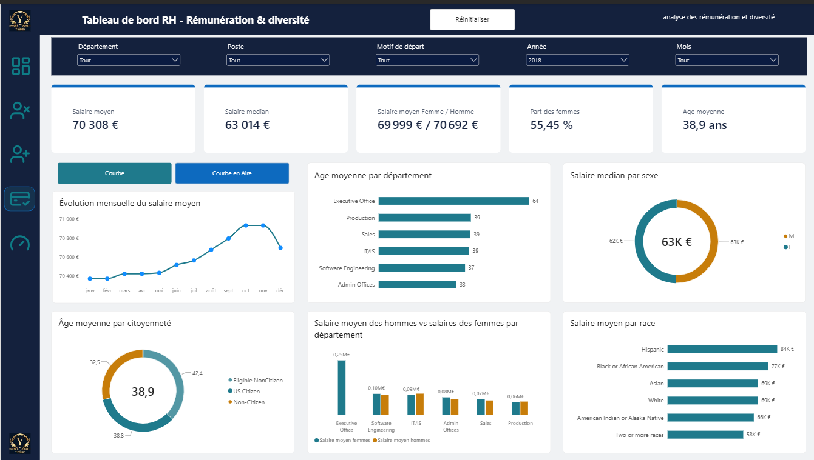
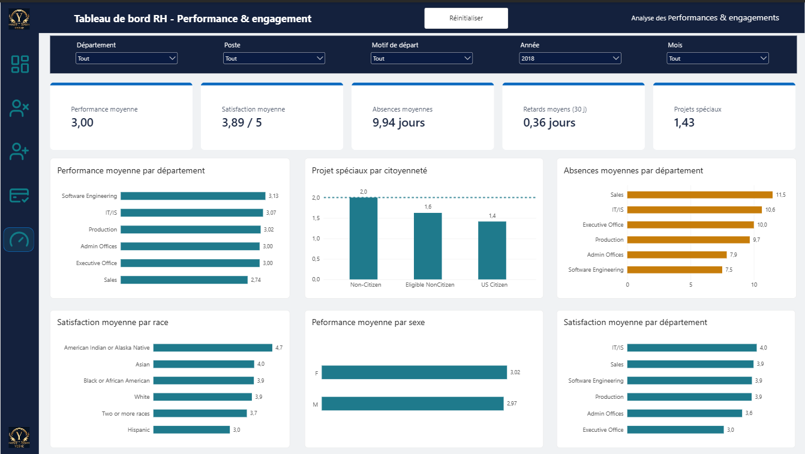
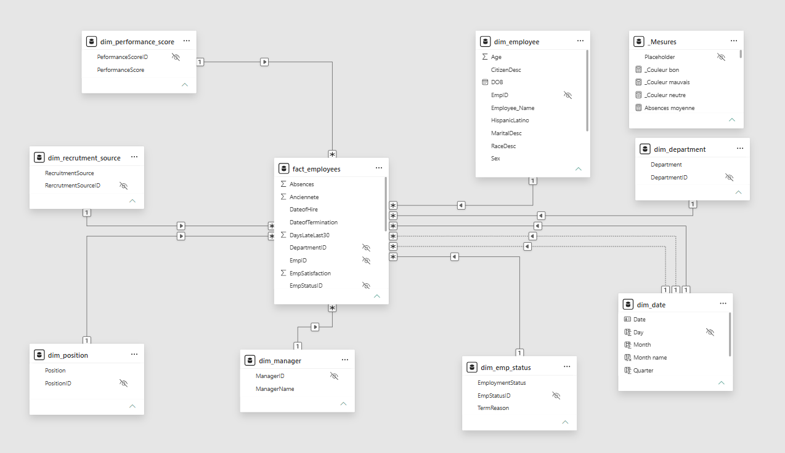
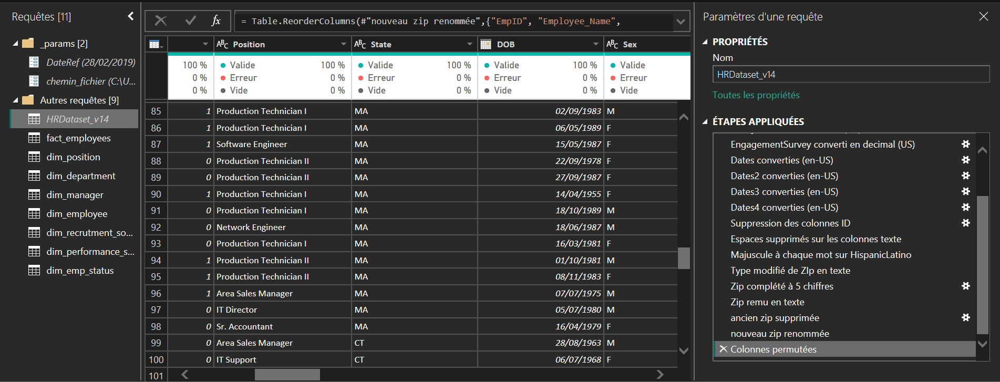
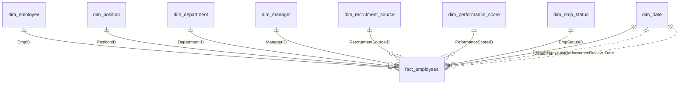

<div align="center">

# 👥 RH – Pilotage des effectifs et de l'attrition

**Tableau de bord Power BI de pilotage des ressources humaines**
Effectifs · Attrition · Recrutement · Rémunération · Démographie · Performance


<br>

[](https://github.com/yebhe/NOM_DU_DEPOT/raw/main/rh_p4_last.pbix)
[](data/)
[](measures/mesures_dax.md)
[](docs/README.md)
[](https://www.linkedin.com/in/yebhe/)

</div>

> ⚠️ **Projet d'apprentissage.** Les données sont fictives et ne représentent aucune entreprise réelle (voir [Limites connues](#-limites-connues)).

---

## 📑 Sommaire

1. [Aperçu du rapport](#-aperçu-du-rapport)
2. [Objectif](#-objectif)
3. [Source des données](#-source-des-données)
4. [Modèle de données](#-modèle-de-données)
5. [Mesures DAX](#-mesures-dax)
6. [Contrôles qualité](#-contrôles-qualité)
7. [Compétences démontrées](#-compétences-démontrées)
8. [Ouvrir le projet](#-ouvrir-le-projet)
9. [Limites connues](#-limites-connues)
10. [Pistes d'amélioration](#-pistes-damélioration)
11. [Structure du dépôt](#-structure-du-dépôt)
12. [Auteur](#-auteur)

---

## 📸 Aperçu du rapport

### Page de synthèse



### Pages thématiques

| Attrition | Recrutement |
|:---:|:---:|
|  |  |
| **Rémunération** | **Performance** |
|  |  |

### Modèle relationnel



---

## 🎯 Objectif

Donner une vue unique des effectifs d'une entreprise, de l'embauche au départ, avec les leviers qui l'expliquent.

| Domaine | Questions auxquelles le rapport répond |
|---|---|
| 👥 **Effectifs** | Combien de salariés, combien d'actifs, quelle ancienneté moyenne ? |
| 🚪 **Attrition** | Combien de départs, quel taux annualisé, quelle part de démissions et de licenciements ? |
| 🎯 **Recrutement** | Quels canaux d'embauche, quelle part de cooptation, quel canal principal ? |
| 💶 **Rémunération** | Quel salaire moyen et médian, quel écart entre femmes et hommes ? |
| 🧑‍🤝‍🧑 **Démographie** | Quelle part de femmes, quel âge moyen, quelles tranches d'âge ? |
| ⭐ **Performance** | Quel engagement, quelle satisfaction, quelles absences et retards, quelle note de performance ? |

Chaque indicateur d'attrition est comparé à la **même période de l'année précédente (N-1)**.

### Quelques repères (sans filtre)

| Indicateur | Valeur |
|---|---:|
| Employés suivis / actifs / partis | 311 / 207 / 104 |
| Démissions / licenciements | 88 / 16 |
| Part des départs volontaires | 84,6 % |
| Pic du taux de départ annualisé | 9,9 % (2016) |
| Salaire moyen / médian | 69 021 € / 62 810 € |
| Salaire moyen femmes / hommes | 67 787 € / 70 629 € |
| Part des femmes / âge moyen | 56,6 % / 39,5 ans |
| Ancienneté moyenne / ancienneté moyenne au départ | 4,8 ans / 3,5 ans |
| Engagement moyen / satisfaction moyenne | 4,11 / 5 et 3,89 / 5 |
| Performance moyenne | 2,98 / 4 |
| Canal de recrutement principal / part de cooptation | 28,0 % (Indeed) / 10,0 % |

### Ce que montrent les données

- **Gel du recrutement** : 60 embauches en 2014, 1 seule en 2018, et un effectif qui passe de 229 (fin 2015) à 207.
- **La Production concentre l'attrition** : 83 des 104 départs, soit 40 % des personnes passées par ce département, contre 16 à 22 % dans Sales, IT/IS et Admin Offices. Software Engineering est aussi à 36 %, mais sur 11 personnes seulement (4 départs).
- **Le canal compte** : 61 % des recrutés via Google Search sont partis, contre 16 % via la cooptation et 8 % via le site web.
- **Engagement et performance vont ensemble** : 4,48 pour les « Exceeds » contre 2,22 pour les « PIP ».

---

## 📊 Source des données

Un fichier source, **HRDataset_v14** (311 employés, une ligne par employé), chargé par Power Query puis éclaté en 1 table de faits et 7 dimensions, auxquelles s'ajoute le calendrier `dim_date`. Jeu de données public à vocation pédagogique, donc fictif. Calendrier du 01/01/2006 au 31/12/2019.

| Date | Première | Dernière |
|---|---|---|
| Embauche | 09/01/2006 | 09/07/2018 |
| Départ | 30/08/2010 | 10/11/2018 |
| Dernière évaluation | 14/07/2010 | 28/02/2019 |

La date de référence des calculs d'âge et d'ancienneté est le **28/02/2019**, portée par le paramètre `DateRef`.

Power Query : une requête par dimension (colonne sélectionnée, doublons supprimés, clé d'index ajoutée), puis fusion de ces dimensions dans la table de faits pour récupérer les clés. Calcul de l'âge et des tranches d'âge dans `dim_employee`, calcul de l'ancienneté en années dans la table de faits (départ ou `DateRef` moins embauche).



---

## 🧱 Modèle de données

Modèle en étoile, mode Import, culture fr-FR : **1 fait**, **8 dimensions**, **10 relations** plusieurs-à-un (filtrage unidirectionnel), dont 2 inactives vers `dim_date`.

Le modèle chargé contient en plus une 11e relation (`dim_employee[DOB]` vers une table de dates automatique) et 2 tables de dates masquées, créées par *Auto date/time*. Elles ne servent à aucun calcul (voir [Pistes d'amélioration](#-pistes-damélioration)).




### Tables

| Table | Rôle (une ligne =) | Lignes |
|---|---|---:|
| `fact_employees` | un employé (salaire, dates, enquêtes, absences) | 311 |
| `dim_employee` | un employé (identité, naissance, localisation, âge) | 311 |
| `dim_position` | un poste | 31 |
| `dim_department` | un département | 6 |
| `dim_manager` | un manager | 21 |
| `dim_recrutment_source` | un canal de recrutement | 9 |
| `dim_performance_score` | Exceeds, Fully Meets, Needs Improvement, PIP | 4 |
| `dim_emp_status` | un statut avec son motif de départ | 20 |
| `dim_date` | un jour, sans trou | 5 113 |
| `_Mesures` | table dédiée aux 62 mesures DAX | – |

`dim_date` est reliée à la date d'embauche (relation active). Les relations sur la date de départ et sur la date de dernière évaluation sont inactives : les départs sont comptés dans la bonne année grâce à `USERELATIONSHIP`, sans dupliquer le calendrier.

---

## 🧮 Mesures DAX

**62 mesures**, toutes dans `_Mesures`, rangées en dossiers d'affichage (`Dashboard`, `Attrition`, `Recrutement`, `Rémunération`, `Démographie`, `Performance`, `Technique`). Les indicateurs d'attrition suivent trois niveaux :

| Niveau | Contenu | Exemple |
|---|---|---|
| **1. Base** | L'indicateur lui-même | `Nb departs` |
| **2. Comparaison N-1** | Année précédente (`LY`) et écart (`PT`), en valeur ou en points pour les taux | `Nb departs LY` |
| **3. Affichage carte** | `Delta` (flèche ▲ ▼ ▶), `Couleur` (vert / rouge / neutre), `Texte` | `Nb departs pt Delta` |

Les couleurs sont centralisées dans `_Couleur bon / mauvais / neutre` (dossier *Technique*). Pour l'attrition, la logique est inversée : une baisse des départs est verte. Aucune mesure n'utilise `TODAY()`.

Les mesures de rémunération, de démographie et de performance retiennent les employés **présents au moins un jour** dans la période sélectionnée (embauchés avant la fin, non partis avant le début).

| Mesure | Définition |
|---|---|
| `Effectif total` / `Employés actifs` | employés distincts, tous / non partis |
| `Nb departs` | départs comptés par date de départ (`USERELATIONSHIP`) |
| `Taux de depart` | départs / (effectif moyen × nombre d'années de la période) |
| `Effectif moyen` | moyenne des effectifs de fin de mois |
| `Demissions` / `Licenciements` | départs volontaires / pour faute |
| `Part des départs volontaires` | démissions / départs |
| `Salaire moyen` / `Salaire median` | salaire de la population présente dans la période |
| `Part des femmes` | femmes / population présente |
| `Engagement moyen` / `Satisfaction moyenne` | enquêtes de 1 à 5 |
| `Performance moyenne` | PIP = 1, Needs Improvement = 2, Fully Meets = 3, Exceeds = 4 |
| `Part canal principal` / `Part de cooptation` | poids du premier canal / de la cooptation dans les embauches |

👉 Détail des mesures de base : [`measures/mesures_dax.md`](measures/mesures_dax.md)

---

## ✅ Contrôles qualité

Contrôles réalisés en lecture seule par requêtes DAX sur le modèle chargé. Aucune anomalie relevée.

| Domaine | Contrôle | Résultat |
|---|---|---|
| Clés | unicité de `EmpID` dans la table de faits et `dim_employee` | 311 lignes, 311 identifiants distincts |
| Cohérence | départ (`Termd` = 1) renseigné sans date, ou date sans départ | 0 incohérence (104 départs) |
| Cohérence | somme des départs par année = total des départs | 104 = 104 |
| Cohérence | effectif de fin 2018 = employés actifs | 207 = 207 |
| Intégrité | lignes de faits sans département, poste ou manager | 0 |
| Plausibilité | salaire, âge, ancienneté, engagement | 45 046 à 250 000 ; 26 à 68 ans ; 0,07 à 13,1 ans ; 1,12 à 5 |
| Dates | calendrier couvrant toutes les dates des faits | 01/01/2006 au 31/12/2019 |

---

## 🧠 Compétences démontrées

| Domaine | Détail |
|---|---|
| **Import et nettoyage (Power Query)** | Éclatement d'un fichier plat en faits et dimensions, clés d'index, fusions, colonnes calculées |
| **Modélisation** | Étoile : 1 fait, 8 dimensions, relations inactives activées à la demande |
| **DAX** | 62 mesures : effectif moyen, taux annualisé, N-1, population présente sur la période, couleurs conditionnelles |
| **Qualité des données** | Contrôles de clés, de cohérence et de plausibilité, limites documentées |
| **Visualisation** | Dashboard et 5 pages thématiques |
| **Qualité du modèle** | Table de mesures dédiée, dossiers d'affichage, descriptions de population |
| **Documentation** | README, schéma du modèle, limites chiffrées |

---

## 🚀 Ouvrir le projet

1. Ouvrir le fichier `rh_p4_last.pbix` dans **Power BI Desktop**.
2. **Accueil → Transformer les données → Gérer les paramètres**, puis vérifier le chemin du fichier source `HRDataset_v14` et la valeur de `DateRef` (28/02/2019).
3. Cliquer sur **Actualiser**.
4. Contrôler : 311 employés, 207 actifs, 104 départs, 62 mesures dans `_Mesures`.

---

## 🚧 Limites connues

- **Historique incomplet avant 2011.** Le premier départ date d'août 2010 et seules 22 embauches précèdent 2011, puis 83 en 2011. Les années 2008 à 2010 reposent sur 6 à 21 salariés : leurs taux ne sont pas interprétables.
- **Dernière année.** Les données de départ s'arrêtent au 10/11/2018 mais le taux 2018 est annualisé sur 12 mois, donc légèrement sous-estimé. Le calendrier va jusqu'à fin 2019 à cause de la date de dernière évaluation : 2019 apparaît sans départ ni embauche.
- **Petits effectifs.** Executive Office compte 1 personne (le salaire de 250 000 est la valeur extrême du jeu), Admin Offices 9 et Software Engineering 11. Les comparaisons par département ou par manager sont fragiles.
- **Salaire.** Les montants sont affichés en euros alors que le jeu d'origine est américain (États, codes postaux). L'écart femmes/hommes (−4 % en moyenne, −2 % en médiane) n'est pas neutralisé par poste ou département.
- **Démissions.** La catégorie « Voluntarily Terminated » regroupe aussi retraite, service militaire et déménagement, ainsi que 2 cas dont le motif est « performance » (1) ou « attendance » (1), qui relèvent plutôt d'un départ subi.
- **Ancienneté et âge.** L'ancienneté mélange actifs (mesurée à la date de référence) et partis (mesurée à leur départ). L'âge est calculé à une date fixe, quelle que soit la période sélectionnée.
- **Performance moyenne.** `PerformanceScore` est une catégorie : la note de 1 à 4 repose sur une échelle choisie, avec le même écart entre chaque niveau.
- **Axes de temps.** Les mesures de salaire, d'engagement et de performance utilisent l'étendue de la période sélectionnée : un axe `Month name` sans année donne une valeur plate. Il faut mettre `Year` en axe.
- **Années sans départ.** `Nb departs` renvoie un vide plutôt que 0, d'où l'affichage « Pas de N-1 » sur les comparaisons.

---

## 🔭 Pistes d'amélioration

- Factoriser le filtre « présent au moins un jour dans la période », recopié dans 10 mesures (mesure de base ou groupe de calcul).
- Remplacer les libellés écrits en dur dans les mesures (« Voluntarily Terminated », « Employee Referral », « Diversity Job Fair ») par des indicateurs dans les dimensions.
- Proratiser le taux de départ de la dernière année sur la période réellement couverte.
- Séparer les départs évitables (démission pour un autre poste, salaire, insatisfaction) des départs non évitables (retraite, service militaire, déménagement).
- Corriger les fautes de nommage (`Rercrutment`, `Peformance`) et les accents des mesures (`Nb departs`, `Demissions`), puis ajouter les descriptions manquantes et retirer la note de développement de la description de `Anciennete moyenne au depart`.
- Désactiver Auto date/time et supprimer la relation sur `DOB`.
- Renommer `1_dashbaord.png` en `1_dashboard.png` (et mettre à jour le lien ci-dessus).

---

## 📂 Structure du dépôt

```
NOM_DU_DEPOT/
├── README.md                  ← ce fichier
├── .gitignore
├── rh_p4_last.pbix            ← rapport Power BI
├── data/
│   ├── README.md              ← description des données
│   └── HRDataset_v14.csv      ← fichier source
├── docs/
│   ├── README.md
│   └── *.png                  ← captures du rapport et du modèle
└── measures/
    └── mesures_dax.md         ← mesures DAX documentées
```

---

## 👤 Auteur

**MAMADOU Lamarana Diallo** · [LinkedIn](https://www.linkedin.com/in/yebhe/)